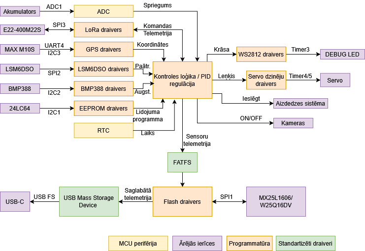
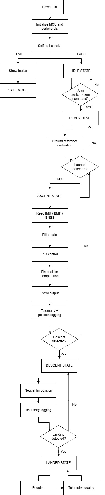

# VERTEX Flight Computer

Avionics system for actively controlled high-power rockets: an STM32 flight computer that estimates vehicle state in real time and drives control actuators, plus a ground station for receiving, storing and analysing flight data.

**Authors:** Miks Balodis, Aleksandrs Jesiļevskis

---

## Overview

The system covers the full avionics chain:

- **Flight computer** – sensor acquisition, state estimation, active control and flight data logging
- **Telemetry link** – LoRa downlink to the ground during flight
- **Ground station** – receiver hardware and a desktop GUI for live visualisation and data export

The flight computer can:

- estimate the rocket's attitude, velocity and altitude in real time,
- drive up to **4 PWM actuator channels** (servo-actuated control fins or a TVC gimbal),
- log flight data on board for post-flight analysis,
- stream telemetry to the ground station during flight.

## What is active control?

Active control continuously:

1. measures the vehicle's state (orientation, angular rates, velocity),
2. computes the required correction,
3. commands the actuators via PWM.

Unlike passive stabilisation, which relies on fixed aerodynamic surfaces, an active system can respond to disturbances such as wind gusts, thrust misalignment and asymmetries during flight.

## Architecture

## Hardware

| Function | Component | Notes |
|---|---|---|
| MCU | STM32F405RGT6 | Cortex-M4F, FPU + DSP, DMA for peripheral transfers |
| Barometer | BMP388 | Altitude estimation; SPI up to 10 MHz |
| IMU | LSM6DSO | 3-axis accelerometer + gyroscope|
| GNSS | u-blox MAX-M10S | ~1.5 m CEP position accuracy, high altitude capable |
| Flight data storage | SPI NOR flash | Exposed to a PC as a USB Mass Storage device |
| Configuration storage | 24LC64 EEPROM | Persistent parameters, separate from flight logs |
| Telemetry | EBYTE E22-400M22S | LoRa operating at 433 MHz |
| Actuators | 4× PWM outputs | Servo driven fins or TVC gimbal |

Flight logs and configuration are deliberately kept on separate memories: the EEPROM is simple to access and keeps configuration safe from being overwritten by logging.

## Software

- **Firmware:** C/C++ on STM32 (STM32CubeIDE / STM32Cube HAL), DMA-driven sensor I/O
- **State estimation:** Kalman filter
- **Control:** PID controller
- **Simulation & tuning:** MATLAB/Simulink for controller and filter design; RocketPy for flight trajectory simulation
- **Ground station GUI:** JavaScript + Svelte, with real time plots and data export
- **PCB design:** KiCad

## Intended users

- student and university rocketry teams
- embedded systems and control algorithm developers
- experimental rocketry and UAV hobbyists

## Deliverables

- Flight computer PCB
- Flight firmware
- Ground station hardware and GUI
- Documentation

## License

All materials in this repository are free to use. Attribution is not required, but a short mention of where they came from is appreciated.

## Contact

For questions, contact Miks Balodis.
